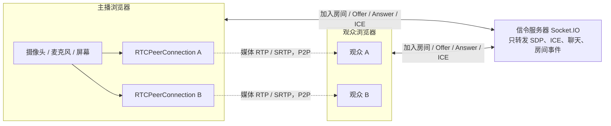
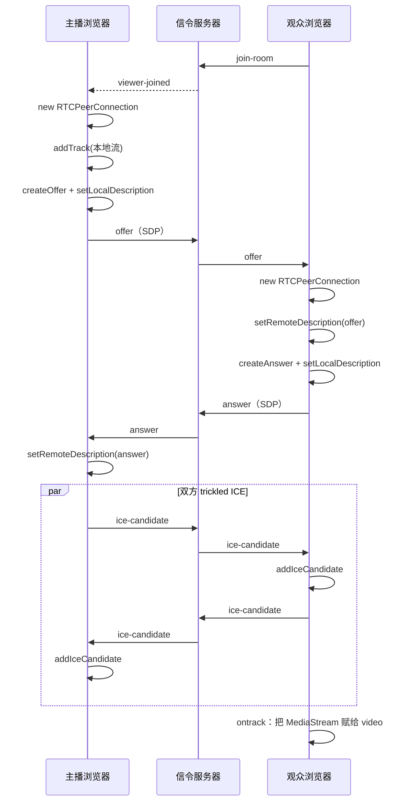

# 研播 Live Lab

一个给开发者上手用的 **WebRTC 一对多直播** 小项目。一个人开播（摄像头 / 麦克风，可选屏幕共享），同一个房间里的多位观众观看，并可以发弹幕。

关键设计：全程使用浏览器原生 API（`RTCPeerConnection`、`getUserMedia`、`getDisplayMedia`），**不用** simple-peer 这类会把 SDP / ICE 藏起来的封装。主播为 **每一位观众单独建立一条** PeerConnection（fan-out）。这不是生产环境的推荐架构，但最适合把握手过程看清楚。

房间右侧有一块一直在的 **学习面板**：用中文记录加入 / 离开、Offer、Answer、ICE 候选，并展示每条连接的 ICE / 信令 / 连接状态，还可以展开最近一份 SDP。

## 运行

需要 Node.js 18 或更高版本。

```bash
cd webrtc-live-learning
npm install && npm start
```

浏览器打开 [http://localhost:3000](http://localhost:3000)。

服务器默认监听 `0.0.0.0:3000`。请优先用 `localhost` 访问：浏览器把 localhost 视为安全上下文，`getUserMedia` 才能申请摄像头。如果用局域网 IP（例如 `http://192.168.x.x:3000`）打开，多数浏览器会拒绝摄像头，这时需要自己配 HTTPS。

环境变量（可选）：

- `PORT`：端口，默认 `3000`
- `HOST`：绑定地址，默认 `0.0.0.0`

## 用两个、三个标签页自测

本机就可以完整走通，不必两台电脑。

1. 第一个标签页打开首页，填个昵称，点 **「创建房间，我来当主播」**。记下六位房间号，或点「复制观看链接」。
2. 第二个标签页打开首页（或直接粘贴观看链接），以观众身份加入。此时主播还没开播，观众会看到等待提示；学习面板里应出现「观众加入」。
3. 回到主播页，点 **「开始直播」**，允许摄像头和麦克风。主播会为已在房间里的观众 `createOffer`，观众回 `Answer`，双方交换 ICE。观众画面应出现，面板上连接状态会变成 `connected`。
4. 再开第三个标签页加入同一房间。这是「已经在播、中途进来的观众」：主播会再新建一条 PeerConnection 并发送 Offer。主播页的观众计数变为 2，学习面板会出现第二条连接。
5. 试一下静音、关闭摄像头、屏幕共享、发弹幕，以及观众关掉标签页。主播应关掉对应那条 PeerConnection；主播点「结束直播」或关闭标签后，观众会收到关播 / 离开提示。

注意：

- 刷新主播页面会断开 Socket，房间会被销毁（没有数据库，故意做成这样）。
- 主播的本地预览是静音的，避免自己听到自己。
- 同一台电脑多个标签页共享同一套摄像头，一般没问题；若提示设备占用，关掉其他正在用摄像头的程序再试。
- 第一次开播时浏览器会弹出权限请求，需要点允许。

## 架构

信令走这台 Node 服务器（Express + Socket.IO）。**音视频不经过服务器**，连通之后在浏览器之间用 SRTP 直传。



主播为每位观众「扇出」一条连接：观众越多，主播的上行带宽和 CPU 就线性增加。这是学习模型，也是下面要对比 SFU 的原因。

## 信令与媒体：逐步走一遍

下面假设主播已经开播，一位新观众加入。代码里对应步骤都有简体中文注释，主要看 `public/js/webrtc.js` 和 `public/js/room.js`。



拆开看：

1. **房间只是信令分组。** 创建房间时服务器生成六位房间号，并把当前 socket 记为主播。观众用同一房间号加入。服务器不保存音视频，也不做账号系统。
2. **谁发起 Offer？** 本项目约定始终由主播发起。这样不会出现双方同时 createOffer 的 glare。观众只负责 `setRemoteDescription(offer)` → `createAnswer` → `setLocalDescription(answer)`。
3. **SDP 是什么？** Offer / Answer 里的 Session Description，用文本描述「我有哪些音视频轨、支持哪些编码、用什么传输地址」。学习面板可以展开最近一份 SDP，对照 `m=video`、`a=ice-ufrag`、`a=fingerprint` 等行。
4. **ICE 候选为什么要排队？** 候选可能在对方的 `setRemoteDescription` 完成之前就到达。过早调用 `addIceCandidate` 会失败，所以 `webrtc.js` 会先把候选放到队列里，远程描述设好后再冲洗。
5. **媒体何时离开服务器？** ICE 协商成功、`connectionState` 变为 `connected` 之后，音视频在两个浏览器之间直传。信令服务器从此只还负责聊天、人数和关播通知。
6. **已开播再进来的观众。** 服务器在 `viewer-joined` 里带上 `isLive`。主播若已在播，立即为新观众新建 PeerConnection 并发送 Offer。若观众来得更早，则等主播点开播时，服务器把当前观众列表一次回给主播，再逐个建连。
7. **观众离开 / 主播关播。** 观众断开时，主播关闭对应那条 PC，避免空连接占着资源。主播关播会 `stop()` 本地轨道、关闭全部 PC，并通知房间里的人。
8. **静音和关摄像头。** 只切换 `track.enabled`，不断开连接，也不重新协商。
9. **屏幕共享。** 对每条连接的 video sender 调用 `replaceTrack`。同一媒体类型下通常不必再走 Offer / Answer，画面会切到屏幕。若一开始是「仅音频」开播，原来没有 video sender，则会 `addTrack` 并补一轮重新协商。

项目没有配置 TURN。在 localhost、以及多数同一局域网环境下，STUN + 主机候选就够了。跨公网、对称 NAT 或企业防火墙时，ICE 可能停在 `checking` / `failed`，那就是该上 TURN 的信号。

## 为什么生产直播多用 SFU，而不是这种 fan-out？

| | 本项目：主播 fan-out（Mesh 的一对多形态） | 生产常见：SFU（如 mediasoup、LiveKit） |
| --- | --- | --- |
| 媒体路径 | 主播浏览器直接向每位观众各发一份流 | 主播只把流推到一台媒体服务器，由服务器转发给观众 |
| 主播上行 | 与观众人数成正比 | 基本上是一份（可加 simulcast 的几档） |
| 主播 CPU | 要为每条连接编码 / 发包 | 压力小得多 |
| 延迟 | 直连，同局域网往往更低 | 多一跳，通常仍可做到很低 |
| 实现复杂度 | 低，便于看清握手 | 需要媒体服务器、路由、权限、流转发 |
| 适合 | 学习、2～3 人演示 | 公开直播、课堂、会议 |

还有 MCU（服务器把多路流混成一路再下发）和 CDN / 协议网关（WHIP 推流，再转 HLS / WHEP 分发）等方案。直播平台很少让主播浏览器直接对成千上万观众建 PeerConnection。

本项目坚持 fan-out，是为了让你亲手写完「一条连接的一生」，再去学 SFU 时知道服务器到底替你省掉了什么。

## 下一步可以学什么

- **SFU**：用 mediasoup 或 LiveKit 把「主播一条上行、服务器多路下行」跑起来，对比本项目的 CPU 和带宽。
- **Simulcast / SVC**：主播同时编码多个清晰度，SFU 按观众网络挑其中一档转发。
- **TURN**：例如 coturn。把手机 4G 和电脑不放在同一网时再测一遍 ICE。
- **WHIP / WHEP**：把 WebRTC 推流、拉流做成标准 HTTP 接口，方便对接专业编码器和 CDN。
- **自适应码率与统计**：读 `getStats()`，根据丢包和往返时延调整约束。
- **录制与转推**：在 SFU 侧把流录成文件，或转推 RTMP。
- **Insertable Streams / 端到端加密**：媒体经过 SFU 但不让服务器看懂内容。

## 目录

```
webrtc-live-learning/
├── package.json
├── README.md
├── server/
│   └── index.js          # Express 静态资源 + Socket.IO 信令
└── public/
    ├── index.html        # 首页：创建 / 加入房间
    ├── room.html         # 房间：播放、控件、弹幕、学习面板
    ├── css/style.css
    ├── assets/favicon.svg
    └── js/
        ├── home.js       # 首页交互
        ├── room.js       # 房间主逻辑（角色、开播、聊天）
        ├── webrtc.js     # RTCPeerConnection 封装（建议先读）
        ├── signaling.js  # Socket.IO 收发，并打到学习面板
        ├── logger.js     # 学习面板
        ├── danmaku.js    # 弹幕
        └── util.js
```

依赖只有 `express` 和 `socket.io`。Socket.IO 的浏览器端脚本由服务器在 `/socket.io/socket.io.js` 提供，无需打包。

## 许可

仅供学习使用，可自由修改。
